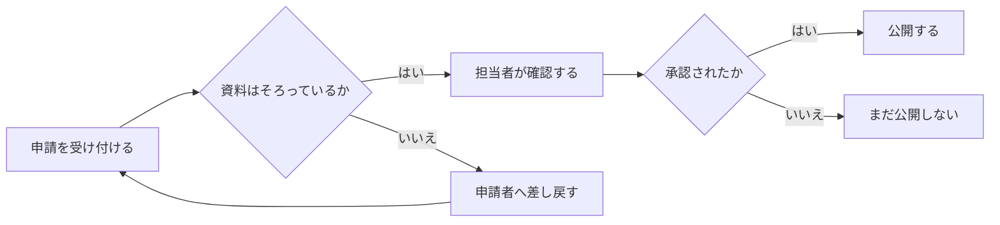
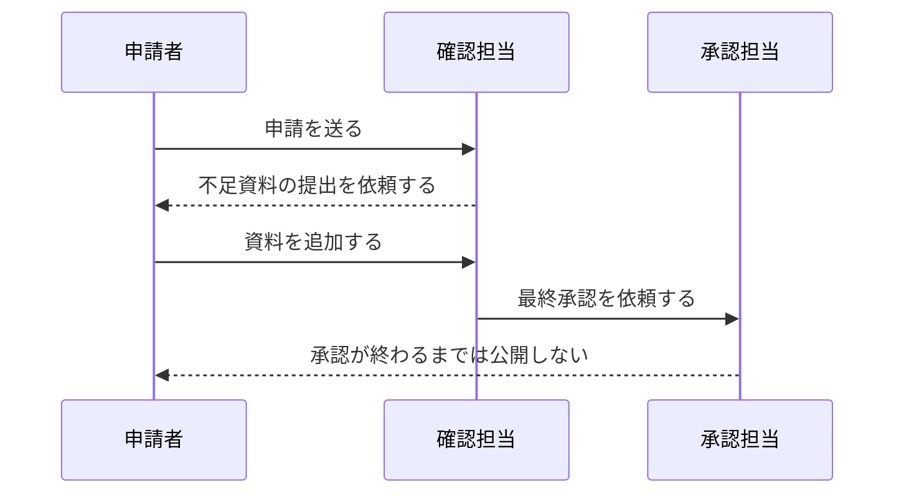

# 本文と図版が混在する報告書

図の中に描かれた文字、Notion の本文、画像のキャプションを区別するためのページです。図版はこの Fixture と一緒に管理している固定 PNG であり、外部サイトの画像変更には依存しません。

## I01｜日本語の分岐図と、その前後の文章

申請は、確認が終わっただけでは公開されません。図の「承認済み」の分岐に進んだ場合だけ公開できます。「差し戻し」は申請者に修正を依頼する分岐です。

I01-FIGURE｜承認手順の図

図の次の本文です。差し戻された申請は、修正した後に再提出できます。却下されたという意味に変えないでください。

## I02｜画像に焼き込まれた文字と、隣接する本文

次のお知らせは画像です。画像内部の原文は「保存しても、まだ公開されません。」です。この文章と、画像の直後にある本文を一つの座標へまとめないでください。

I02-FIGURE｜画像に埋め込まれたお知らせ

画像の後の本文：公開する前に、担当者の承認を受けてください。画像内の「閉じる」は画面上の本物のボタンではありません。

<columns>
<column ratio="45">
短い補足

本文として取得できる原文です。画像内の文字を AX のテキストとして取得できるとは限りません。
</column>
<column ratio="55">
別の補足

画面に見える文字をすべて対象にする場合、画像領域は OCR で補う必要があります。見えていない文字を、キャプションから推測して補ってはいけません。
</column>
</columns>

## I03｜グラフの軸・凡例・数値・注釈

図の単位は「件」であり「秒」ではありません。棒の高さだけを見て、処理時間が長くなったと翻訳しないでください。図の下にある対象外の注釈も確認します。

I03-FIGURE｜数値と注釈を含む図

図の後の結論：完了件数は増えましたが、再申請を含まない値です。受付件数全体と同じではありません。

## I04｜編集可能な Mermaid の分岐図



図の読順は矢印で決まります。画面上で左から右に文字を並べただけでは、分岐条件と処理の対応を失うことがあります。Mermaid の表示モードは Notion UI 側で切り替えてください。

## I05｜発言者と時間の向きがある図



依頼した人と依頼された人を逆にしないでください。点線の矢印も含め、図中の文章が誰から誰へ送られたものか確認します。

## I06｜等幅の図と、通常の文章

```text
┌──────────────┐      ┌──────────────┐
│ 申請を受け付ける │ ──→ │ 資料を確認する   │
└──────────────┘      └──────┬───────┘
                           │ 不足あり
                           ▼
                    ┌──────────────┐
                    │ まだ公開しない   │
                    └──────────────┘
```

等幅表示が崩れたとき、囲み線を文字として誤認したり、「不足あり」を別の図のラベルと結合したりしないか確認します。

I-END｜画像を含む文書の末尾です。画像や図を通り過ぎてスクロールした後に、古い図中の座標を残さないでください。
